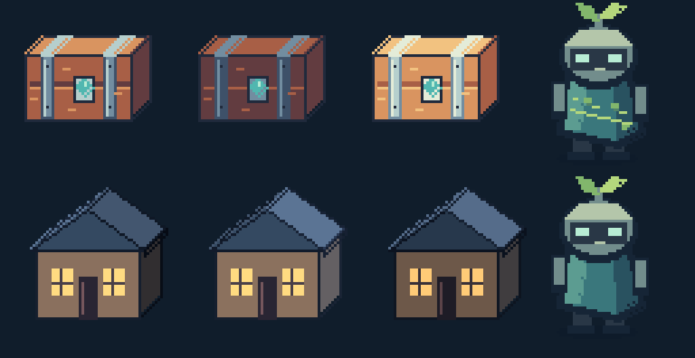

# Pixel Painter

Pixel Painter is an offline pixel-art CLI and Rust library. Make sprites, tiles,
buildings, and animations with commands or editable JSON, then export PNGs and
engine-neutral metadata. No account, cloud service, or image model is required.

**v0.4.0** adds material palette shading, mask-constrained brushes, isolated-layer
inspection, and built-in lighting reviews. [Download the stable release](https://github.com/bstuddard/pixel-painter/releases/latest)
for Linux, Windows, or macOS, or build from source below.



The top row shows one chest with baseline, shadow, and highlight material ramps,
plus a sentinel painted through a cloak mask. The bottom row shows the same cottage
under three light directions and the sentinel before painting. All art and review
images were produced by `painter`.

## See what it can make

| Example | Review output | Editable inputs and capabilities |
|---|---|---|
| [Material and brush workshop](rust/examples/workshop/README.md) | [Chest variants](rust/examples/workshop/01-material-chest/export/preview.png), [masked painting](rust/examples/workshop/02-masked-sentinel/export/preview.png) | Explicit wood/steel ramps, reusable brush, protected silhouette, raw/solo layers, seven-view lighting sheets |
| [Village Corner](rust/examples/village/README.md) | [Assembled scene](rust/examples/village/scene.png), [directional character](rust/examples/village/export/assets/0000/export/preview.png) | Parameterized buildings, terrain, stairs, anchors, split-layer overlap, and coherent asset families |
| [Three-map lighting](rust/examples/lighting/README.md) | [Lighting comparison](rust/examples/lighting/overview.png), [animated neon](rust/examples/lighting/01-neon-sign/export/animation.png) | Pixel-aligned color/emissive/normal maps, geometry normals, animation, vector-aware transforms |
| [Original gallery](rust/examples/gallery/README.md) | [Gallery overview](rust/examples/gallery/overview.png), [animated keeper](rust/examples/gallery/01-crystal-keeper/export/animation.png) | Layered characters, moss cottage, tiles, seeded creatures, reusable components |


## How to use it

Extract a [native download](https://github.com/bstuddard/pixel-painter/releases/latest)
into a writable folder and run `./painter --help` (Windows: `.\painter.exe --help`).
The download includes its own README, examples, and guides; Rust is only needed
when building the source. For source users, install Rust 1.88 or newer and run
from this repository's root:

```sh
cargo build --release --locked --manifest-path rust/Cargo.toml
PAINTER=./rust/target/release/painter
```

Create a small crystal, edit it, and export it. For a native download, set
`PAINTER=./painter` first. These shell commands create `gem.json` in the current
folder; use a fresh filename when repeating them.

```sh
"$PAINTER" --file gem.json new --width 32 --height 32
"$PAINTER" --file gem.json draw polygon --points 16,3,28,14,16,29,4,14 --color '#253347' --fill
"$PAINTER" --file gem.json draw polygon --points 16,5,25,14,16,25,7,14 --color '#51B7B0' --fill
"$PAINTER" --file gem.json draw --alpha-lock line --x1 8 --y1 13 --x2 16 --y2 6 --color '#B7ECD4'
"$PAINTER" --file gem.json render --output gem-preview.png --scale 8
"$PAINTER" --file gem.json export --output gem.png
"$PAINTER" --file gem.json preview --output gem-review --scale 4
```

Open `gem-preview.png` to inspect the enlarged artwork and `gem.png` for the
native 32×32 engine asset. `gem-review/contact-sheet.png` compares color, maps,
emission, and lighting; `review.json` contains map diagnostics. Coordinates start
at `(0, 0)` in the top left. Edits save to the named JSON file; render/export/review
leave it unchanged. New outputs refuse overwrites. Run edits sequentially.

Review a complete animated example without editing it:

```sh
"$PAINTER" --file rust/examples/workshop/01-material-chest/project.painter.json preview --output chest-review --all-frames --scale 4
"$PAINTER" --file rust/examples/workshop/01-material-chest/project.painter.json render --solo-layer normals --raw --output chest-normals.png --scale 4
```

In native downloads, example paths start with `examples/` instead of
`rust/examples/`. Use `--json` for versioned structured results and errors.
For repeated or AI-generated edits, put operations in a JSON batch and validate
with `batch --input edits.ops.json --dry-run` before applying it.
The [authoring and review guide](docs/authoring-and-review.md) walks through
material ramps, masks, reusable brushes, isolated layers, and lighting diagnostics.

## Capabilities

- Integer lines, rectangles, ellipses, polygons, flood fill, erase, and clear.
- Versioned transactional JSON batches with dry-run, indexed errors, and work limits.
- Named palettes, explicit material ramps, strict/nearest mapping, and inspection.
- Snapshot masks, alpha-locked brushes, isolated-layer previews, and lighting review bundles.
- PNG import/export with exact eight-bit RGBA and explicit sixteen-bit reduction.
- Snapshot region copy/paste, reusable components, flips, rotate, move, crop, resize.
- Versioned projects with layers, visibility, opacity, explicit migration, checkpoints.
- Frames, durations, pivots, directional tags, sprite sheets, APNG, and metadata.
- Tiles, source/output spacing, stable IDs, adjacency rules, and exact seam checks.
- Parameterized recipes, reusable parts, named variants, and reproducible u64 seeds.
- Shared style profiles, measurable palette/outline checks, and animation QA.
- Pixel-aligned roof, facade, prism, and stair helpers, plus baked shadow projection.
- Ground/attachment anchors, footprints, and split-layer exports for overlap.
- Offline scene previews, contact sheets, and complete asset-family generation/checks.

The workflow is **commands or recipes → editable source → review → PNG/JSON**.
Use [coherent asset families](docs/coherent-assets.md) for profiles, parameterized
recipes, depth helpers, scenes, placement, animation checks, and packs.
The [CLI and format guide](docs/cli-and-formats.md) specifies schemas, command
examples, pixel semantics, error contracts, file-safety behavior, and limits.
The [original roadmap](docs/roadmap.md) and [coherent-assets roadmap](docs/coherent-assets-roadmap.md) record the implementation scope.
The [security review](docs/security-review.md) describes input/file protections,
dependency audit results, and the unresolved advisories in the optional consumer.
The [standalone Macroquad consumer](integrations/macroquad/README.md) animates the
exported character from metadata without linking the painter library.

## Rust library

The same package builds a reusable library and the `painter` executable:

```rust
use painter::{Canvas, Pixel};

fn main() -> Result<(), Box<dyn std::error::Error>> {
    let mut canvas = Canvas::new(32, 32)?;
    canvas.set_pixel(4, 2, Pixel::rgba(255, 128, 0, 255))?;
    painter::storage::export_png(std::path::Path::new("sprite.png"), &canvas)?;
    Ok(())
}
```

Canvas and project deserialization validate their invariants. Batches commit only
on success; persistence is explicit. Before 1.0, Rust APIs and file formats may change between minor releases.
Breaking changes are documented in the changelog; keep editable source backups.

Library consumers can disable the default `cli` feature to omit Clap:

```toml
[dependencies]
painter = { path = "../pixel-painter/rust", default-features = false }
```

Rust callers can match the typed `ErrorCode` enum or inspect native causes through
`std::error::Error::source()`. JSON diagnostics retain their documented string codes.

## Development and examples

From `rust/`:

```sh
cargo fmt --all -- --check
cargo clippy --all-targets --locked -- -D warnings
cargo test --locked
cargo test --no-default-features --locked
cargo test --release --locked
RUSTDOCFLAGS='-D warnings' cargo doc --no-deps --locked
```

From the repository root, regenerate the entire gallery into a new folder:

```sh
cargo build --release --locked --manifest-path rust/Cargo.toml
python3 rust/examples/generate_gallery.py --painter rust/target/release/painter --output /tmp/painter-gallery
python3 rust/examples/generate_village.py --painter rust/target/release/painter --output /tmp/painter-village
python3 rust/examples/generate_lighting.py --painter rust/target/release/painter --output /tmp/painter-lighting
python3 rust/examples/generate_workshop.py --painter rust/target/release/painter --output /tmp/painter-workshop
```

The generator requires Python 3's standard library and invokes the actual CLI
for all raster editing. It never deletes or overwrites an existing destination.
`SHA256SUMS` records every artifact; CI compares regenerated output to the checked-in
set. Tests cover CLI workflows, exact pixels, alpha, transforms, rollback,
limits, malformed inputs, project round trips, atlas/APNG decoding, and seams.

The original [soccer-ball example](rust/examples/soccer-ball.json) remains usable:

```sh
cargo run --locked --manifest-path rust/Cargo.toml -- --file rust/examples/soccer-ball.json view
```

## Downloads and releases

The [release workflow](.github/workflows/release.yml) builds native Linux x86_64,
Windows x86_64, and both Mac architectures. Tag pushes and manual trial builds
produce reviewable Actions artifacts. Stable release publication requires a manual
dispatch with `publish` explicitly enabled and an existing tag matching the Cargo
version. Every release runs the shared checks against its exact source commit.

Downloads include a matching README, examples, format/security guides, changelog,
license texts, dependency notices, build information, and checksums. Matching
source archives vendor dependencies for offline builds of the core and optional
consumer. Binaries are unsigned and not notarized. The `painter` executable and
library names are unchanged; crates.io publication is disabled because that
registry name belongs to another project.

See [release preparation](docs/release-review.md) for local archive checks and the
remaining hosted validation. Release tooling requires Python 3.12 or newer and
uses only its standard library. The [check workflow](.github/workflows/checks.yml)
covers Linux, Windows, macOS, Rust 1.88, dependency audits, gallery reproducibility,
and standalone Cargo packaging. Local checks run on Linux; native Windows/macOS
claims require successful hosted jobs.

## License

[GNU GPLv3 only](LICENSE). Includes sample artwork; your own independently created
artwork does not automatically inherit this license.
