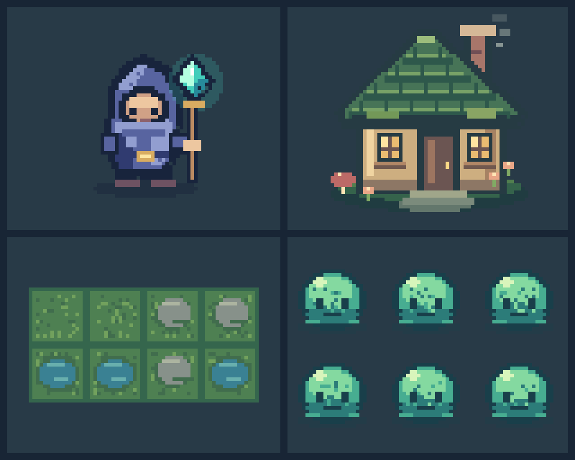

# Pixel Painter

A Rust library and CLI for deterministic pixel-art creation, revision, layered
animation, and game-ready asset exports. The core works independently of any
engine and does not require a graphical editor or cloud service.



Open the [review gallery](rust/examples/gallery/README.md) for enlarged previews,
an animated character, a layered cottage, terrain tiles, seeded variants, and
primitive/component examples. Every folder includes editable inputs and outputs.

## Quick start

Install stable Rust (1.88 or newer), then run from the repository root:

```sh
cd rust
cargo run --locked -- new --width 32 --height 32
cargo run --locked -- draw rect --x 8 --y 8 --width 16 --height 16 --color '#5864A0' --fill
cargo run --locked -- set-pixel --x 12 --y 12 --r 255 --g 220 --b 160
cargo run --locked -- view
cargo run --locked -- render --output preview.png --scale 8
cargo run --locked -- export --output artwork.png
```

Commands share `canvas.json`. Use global `--file PATH` for another canvas and
`--json` for structured results/errors. Coordinates start at `(0, 0)` at top left.
Existing v0.1.1 canvas JSON and commands remain supported. Newly created artwork
and exports refuse to overwrite files. Run edits sequentially.

## Capabilities

- Integer lines, rectangles, ellipses, polygons, flood fill, erase, and clear.
- Versioned transactional JSON batches with dry-run, indexed errors, and work limits.
- Named palettes, strict/nearest mapping, inspection, and nearest-neighbor previews.
- PNG import/export with exact eight-bit RGBA and explicit sixteen-bit reduction.
- Snapshot region copy/paste, reusable components, flips, rotate, move, crop, resize.
- Versioned projects with layers, visibility, opacity, explicit migration, checkpoints.
- Frames, durations, pivots, directional tags, sprite sheets, APNG, and metadata.
- Tiles, source/output spacing, stable IDs, adjacency rules, and exact seam checks.
- Data-driven templates and reproducible procedural variations using u64 seeds.

The [CLI and format guide](docs/cli-and-formats.md) specifies schemas, command
examples, pixel semantics, error contracts, file-safety behavior, and limits.
The [tightened roadmap](docs/roadmap.md) records the implementation contract.
The [security review](docs/security-review.md) describes input/file protections,
dependency audit results, and the unresolved advisories in the optional consumer.
The [standalone Macroquad consumer](integrations/macroquad/README.md) animates the
exported character from metadata without linking the painter library.

## Rust library

The same package builds a reusable library and the `painter` executable:

```rust
use painter::{Canvas, Pixel};

fn main() -> Result<(), Box<dyn std::error::Error>> {
    let mut canvas = Canvas::new(32, 32)?;
    canvas.set_pixel(4, 2, Pixel::rgba(255, 128, 0, 255))?;
    painter::storage::export_png(std::path::Path::new("sprite.png"), &canvas)?;
    Ok(())
}
```

Canvas and project deserialization validate their invariants. Batches commit only
on success; persistence is explicit. Public Rust APIs may evolve before 1.0;
versioned file contracts remain supported or receive explicit migrations.

Library consumers can disable the default `cli` feature to omit Clap:

```toml
[dependencies]
painter = { path = "../pixel-painter/rust", default-features = false }
```

Rust callers can match the typed `ErrorCode` enum or inspect native causes through
`std::error::Error::source()`. JSON diagnostics retain their documented string codes.

## Development and examples

From `rust/`:

```sh
cargo fmt --all -- --check
cargo clippy --all-targets --locked -- -D warnings
cargo test --locked
cargo test --no-default-features --locked
cargo test --release --locked
RUSTDOCFLAGS='-D warnings' cargo doc --no-deps --locked
```

From the repository root, regenerate the entire gallery into a new folder:

```sh
cargo build --release --locked --manifest-path rust/Cargo.toml
python3 rust/examples/generate_gallery.py --painter rust/target/release/painter --output /tmp/painter-gallery
```

The generator requires Python 3's standard library and invokes the actual CLI
for all raster editing. It never deletes or overwrites an existing destination.
`SHA256SUMS` records every artifact; CI compares regenerated output to the checked-in
set. Tests cover legacy workflows, exact pixels, alpha, transforms, rollback,
limits, malformed inputs, project round trips, atlas/APNG decoding, and seams.

The original [soccer-ball example](rust/examples/soccer-ball.json) remains usable:

```sh
cargo run --locked --manifest-path rust/Cargo.toml -- --file rust/examples/soccer-ball.json view
```

## Downloads and releases

The [release workflow](.github/workflows/release.yml) builds native Linux x86_64,
Windows x86_64, and both Mac architectures. Tag pushes and manual trial builds
produce reviewable Actions artifacts. Public preview publication requires a manual
dispatch with `publish` explicitly enabled and an existing tag matching the Cargo
version. Every release runs the shared checks against its exact source commit.

Downloads include a matching README, examples, format/security guides, changelog,
license texts, dependency notices, build information, and checksums. Matching
source archives vendor dependencies for offline builds of the core and optional
consumer. Binaries are unsigned and not notarized. The `painter` executable and
library names are unchanged; crates.io publication is disabled because that
registry name belongs to another project.

See [release preparation](docs/release-review.md) for local archive checks and the
remaining hosted validation. Release tooling requires Python 3.12 or newer and
uses only its standard library. The [check workflow](.github/workflows/checks.yml)
covers Linux, Windows, macOS, Rust 1.88, dependency audits, gallery reproducibility,
and standalone Cargo packaging. Local checks run on Linux; native Windows/macOS
claims require successful hosted jobs.

## License

[GNU GPLv3 only](LICENSE). Includes sample artwork; your own independently created
artwork does not automatically inherit this license.
