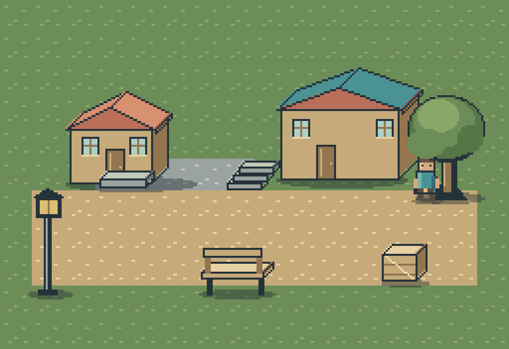

# Village Corner



Review `scene.png` for shared scale, light, perspective, and overlap;
`export/contact-sheet.png` for individual assets; `character/contact-sheet.png`
for four-direction idle/walk frames; and `style-reference.png` for palette roles.
The character stands between the exported tree trunk and canopy.

`pack-check.json`, `generation-check.json`, and `character/check.json` contain
measurable validation results. They do not grade artistic quality.
`projected-shadow.png` demonstrates the separate bounded silhouette projector.

All artwork was independently authored for this public toolkit. Every raster
pixel was produced by painter CLI operations, without external artwork or image
generation. These samples are GPL-3.0-only, like the repository; using painter
does not impose this license on independently authored user artwork.

Edit `profile.json`, `recipes/`, the character/tree projects, or `scene.json`.
`pack.recipe.json` assembles the family; `export/pack.json` indexes the results.
Tree placement contains ground/attachment/footprint metadata and split layers.
Cottage and workshop share one parameterized recipe with reusable windows/door.
Curbs and stairs use the same bounded face helpers as buildings and props.

Reproduce into a new folder from the repository root:

```sh
cargo build --release --locked --manifest-path rust/Cargo.toml
python3 rust/examples/generate_village.py --painter rust/target/release/painter --output /tmp/painter-village
diff rust/examples/village/SHA256SUMS /tmp/painter-village/SHA256SUMS
```

Paths inside JSON are relative to their configuration directory. No private
downstream project, local machine path, or external service is required.
